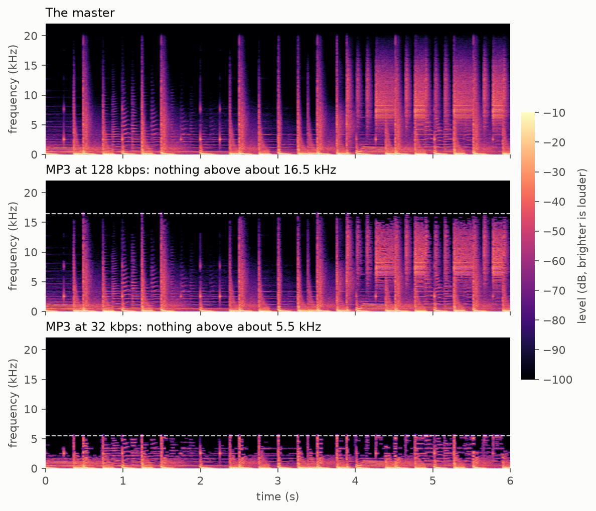
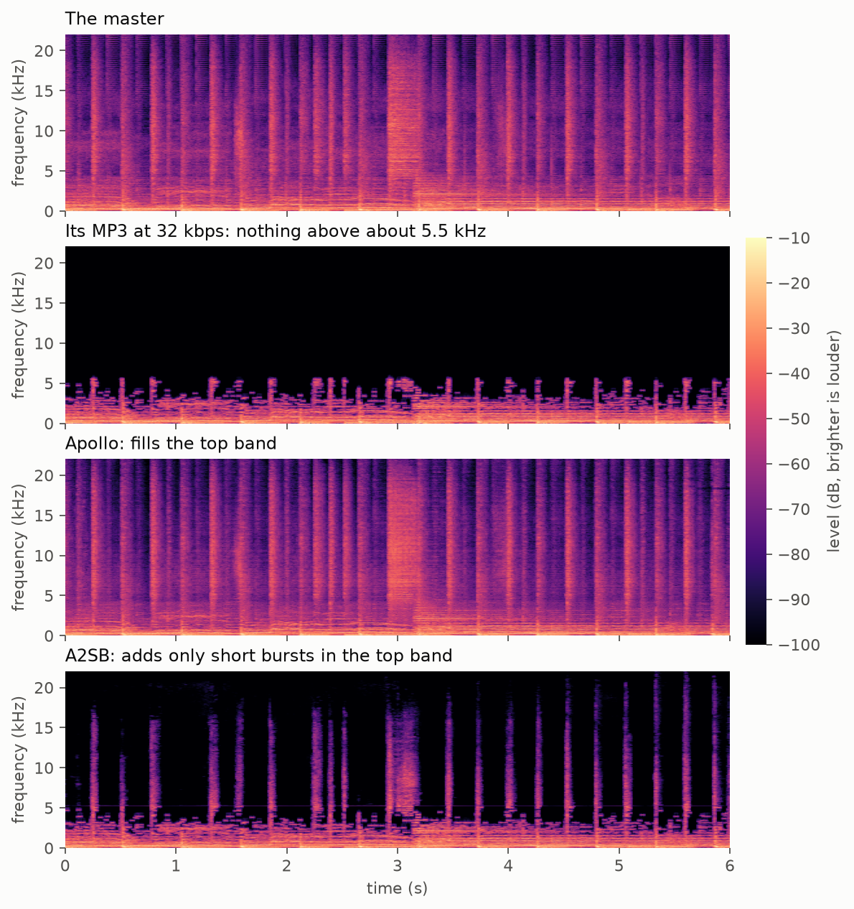
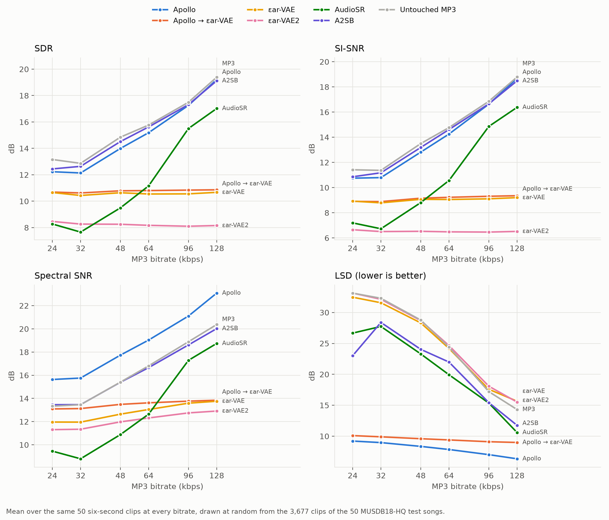

# grooveback

**Restoring records that survive only as MP3, AAC or Opus rips.**

**[Listen to the results](https://zbitouzakaria.github.io/grooveback/listen/)**: clean tracks, their MP3 copies, and
the restorations described below.

As a DJ and listener, I keep running into the same problem: records I love that now exist only as rips on YouTube. A rip
is a copy someone made of their own record. They played the vinyl through an imperfect turntable setup, saved the
recording as a 128 or 192 kbps MP3, and uploaded it. YouTube then compressed it again, to AAC or Opus. On laptop
speakers the rips sound fine. On a good sound system the damage is easy to hear: drum hits lose their sharp edge, the
shimmer of the cymbals is gone, and the track sounds flat and tired next to the rest of the library.

This project tries to restore them, starting with electronic music: old-school house, minimal, and nearby genres.

## What an MP3 throws away

Sound is a mix of frequencies: low ones for the bass and the kick drum, high ones for hi-hats and cymbals. People hear
from about 20 Hz to 20 kHz, that is, from 20 to 20,000 vibrations per second. A CD stores the sound wave as a long list
of numbers, 44,100 per second for each of the two stereo channels; each number is a sample. That makes 1,411 kilobits of
data per second (1,411 kbps). An MP3 at 128 kbps stores about a tenth of that, and one at 32 kbps less than a fortieth.

To fit, the encoder, the program that compresses the audio, drops what the ear is least likely to miss, much as JPEG
does for photos. It removes every frequency above a cut-off, the top band. It stores the rest with less precision, which
blurs short, sharp sounds such as a drum hit, and when it runs short of data it drops quiet parts entirely. This is
lossy compression: decoding the file cannot bring back what was dropped. MP3, AAC and Opus all drop what the ear is
least likely to miss; each is a codec, short for coder-decoder.

The picture below shows this on 6 s of an electronic track, Aerofunk's "Nice One". It is a spectrogram: time runs left
to right, frequency runs bottom to top, and brighter means louder. Level is in decibels (dB), a scale for comparing two
quantities, where every 10 dB means ten times more energy. In this picture, 0 dB is the loudest a file can hold, so real
levels are negative. Each vertical stripe is a drum hit. The master, the clean version of the track as released, reaches
20 kHz. Its MP3 at 128 kbps keeps nothing above about 16.5 kHz. At 32 kbps it keeps nothing above 5.5 kHz, and dark
holes, the dropped quiet parts, appear below the cut-off too.

At 128 kbps, the lost precision below the cut-off is too fine to see in this picture.

A rip from YouTube was compressed at least twice: once by the person who uploaded it, and again by YouTube, which serves
its standard streams as roughly 128 kbps AAC or Opus ([YouTube audio formats](#ref-ytformats)).

## A restorer has to invent what the codec removed

Because the information is gone, restoring a rip cannot mean recovering the master. A restorer has to invent the missing
sound. Its output can be plausible, consistent with the rip and convincing on good speakers, but not faithful: it will
not match the master exactly.

That makes restoration a job for a generative model, a neural network trained on many examples until it can produce new
ones of the same kind. Our plan is a generative model of clean house and minimal music, made by training [Stable Audio
3](#ref-sa3), a public music generator, further on my library of about 215 hours. We call this model the prior: it knows
only what clean music sounds like. A second program, the solver, runs the prior and steers what it generates toward a
clean track that matches the rip. Only the solver knows about the damage, so a new kind of damage, such as vinyl
crackle, means changing the solver, not retraining the prior
([ADR-0004](docs/decisions/0004-restoration-as-a-latent-inverse-problem.md)).

We have not trained the prior yet. First we measured what the existing tools do, and that is what the next section
reports. Each finding links to its decision record (ADR), a short write-up of the experiment and its evidence, in
[`docs/decisions/`](docs/decisions/).

## What we found

We started with two models that anyone can download and run ([ADR-0006](docs/decisions/0006-baseline-findings.md)):
[Apollo](#ref-apollo), a neural network trained to repair MP3-compressed music, and [A2SB](#ref-a2sb), which fills in
the top band above a cut-off. We tried them on two inputs: Apollo's own 6 s test clip, a heavily damaged copy whose
sound stops at about 5 kHz, like a 32 kbps MP3; and one real 128 kbps rip (AN-2, "Moonshine", 7.6 min). We listened on
studio headphones, with every track at the same loudness, because a louder track tends to sound better.

On the 6 s clip, Apollo won clearly: it put back a full hi-hat where A2SB added a click. On the 128 kbps rip, both
models filled the band above its cut-off (15.75 kHz here; the exact cut-off depends on the encoder), yet the MP3, Apollo
and A2SB all sounded the same on headphones. We have not yet compared them on speakers. Apollo also runs faster than
real time on a laptop and keeps left and right separate. A2SB works in mono only, and took about 35 minutes for the
7.6-minute track on an A100 GPU.

Apollo's authors ship their test clip already damaged; we also have a clean version of it. So that the picture below can
show the master too, it uses our own 32 kbps MP3 of the clean version, the same as on our listening page. In the
picture, Apollo fills the top band and the holes below the cut-off, while A2SB adds short bursts above the cut-off and
leaves the holes.

We also tried [SonicMaster](#ref-sonicmaster), which takes a typed instruction, through its online demo, and dropped it:
it adds extra kick drums on electronic music, even when the instruction says not to
([ADR-0005](docs/decisions/0005-baselines-and-prior-viability-on-real-library-material.md)).

### Stable Audio 3's clips hold detail for an MP3 to remove

Our plan depends on [Stable Audio 3](#ref-sa3), and a prior that cannot generate fine detail cannot put it back. So we
checked whether its music models generate the fine detail a master has
([ADR-0008](docs/decisions/0008-sa3-generation-probe.md)). We compressed their clips to 64 kbps MP3 and scored each MP3
against its clip with SDR (signal-to-distortion ratio), a score in dB of how close two recordings are, sample by sample.
A higher score means the MP3 lost less, so a clip without fine detail would score high. Averaged over three random runs,
the four music models score between 10.3 and 21.3 dB, and a 64 kbps MP3 of a real master, an excerpt of "Nice One",
scores 17.6 dB, inside that range. So the models generate about as much detail for an MP3 to remove as a real master
has. This is one prompt: it does not show that they sound like a master.

### SDEdit keeps the damage it should remove

Our first method was [SDEdit](#ref-sdedit) with Stable Audio 3's medium model
([ADR-0009](docs/decisions/0009-sdedit-as-the-first-solver.md)). It adds noise to the MP3 and lets the model remove it,
in the hope that the codec damage goes with it. It did not: to the model, music with its top band missing is still
plausible music, so it keeps it, and no setting filled the missing band. Removing the damage would take more noise than
the model can handle before it starts changing the music itself. We rejected SDEdit. This used the public model, not our
trained prior, so we will test it again once the prior exists.

### Running εar-VAE after Apollo helps on heavy damage, by ear

Next we tried four open autoencoders, networks that compress audio into a much shorter list of numbers and rebuild it.
One trained on clean music tends to rebuild what it hears as clean music, so it might clean an MP3 on the way through.
We tried [SAME-L](#ref-same), [εar-VAE](#ref-earvae), [εar-VAE2](#ref-earvae2) and [CoDiCodec](#ref-codicodec)
([ADR-0011](docs/decisions/0011-benchmark-autoencoder-roundtrips-and-mean-damage-subtraction.md)). We passed the MP3, or
Apollo's output, through each one and back, and tried a damage subtraction that removes the average change an MP3 makes
to those numbers.

By ear, Apollo → εar-VAE, Apollo's output passed through εar-VAE, is the best on heavy damage: it beats Apollo alone at
32 kbps, the verdict is split at 64 kbps, and it loses at 128 kbps. The εar-VAE damage subtraction is also worth
keeping; plain round trips of the MP3 sounded worse than these two. Every score we computed, SDR included, rates Apollo
→ εar-VAE below Apollo alone at every bitrate. A score shows how far a restoration is from the master, not whether it
sounds better, so here we trust the ear. Our listening is not blind yet: we knew which track was which. Whether any
method makes a 128 kbps MP3, the bitrate of a typical rip, sound better than it already does is still open.

### The MUSDB18-HQ benchmark

Scores cannot tell us what sounds better, but they are how published work compares methods. Apollo is our baseline, so
we also score it with its authors' own code and protocol
([ADR-0015](docs/decisions/0015-reproduce-apollo-test-protocol.md)): on 6 s clips of the 50 test songs of MUSDB18-HQ, a
public research dataset, compressed to MP3 at 24 to 128 kbps. According to [Apollo's
maintainer](https://github.com/JusperLee/Apollo/issues/46#issuecomment-6281774888), the released model was not trained
on these songs. On the same clips at 24 kbps, our evaluation gives the same average scores as the authors' own
evaluation script. We also fixed a bug in their MP3 simulation that left 2.5% of the 24 kbps clips 25 ms late; the
scores compare sample by sample, so a 25 ms shift lowers them sharply. On all 3,677 clips, Apollo's SDR rises from
11.9 dB at 24 kbps to 19.1 dB at 128 kbps: these are the numbers we will compare our own methods with.

We then scored four more methods the same way
([ADR-0016](docs/decisions/0016-score-audiosr-a2sb-and-autoencoders-on-musdb.md)): A2SB, AudioSR, and the round trips of
the MP3 through εar-VAE and through εar-VAE2. [AudioSR](#ref-audiosr) is another model that fills in the top band; we
had not run it before. A2SB and AudioSR take 7 to 37 s per clip on a rented GPU, so we scored every method on the same
50 clips, drawn at random. On these 50 clips the averages differ from those on all 3,677 by up to 0.4 dB: Apollo
scores 12.2 dB at 24 kbps in the figure, against 11.9 dB on all clips.

SDR and SI-SNR (scale-invariant signal-to-noise ratio, which ignores overall volume) are the authors' scores; higher is
better. Spectral SNR (higher is better) and the log-spectral distance (LSD, lower is better) are ours: they compare only
how much energy each frequency has over time, as a spectrogram shows it. The grey line scores the untouched MP3 the same
way.

None of the four scores above the untouched MP3 on SDR. A2SB comes closest, 0.1 to 0.7 dB under it: it keeps the MP3's
sound below a point 250 Hz under the cut-off and rebuilds only the band above that point, which lowers its LSD. AudioSR
scores 2.0 to 5.4 dB under the MP3. It fills the band above the cut-off, but it also rewrites part of the band the MP3
kept: at 64 kbps it changes the sound from 8 kHz up, while the MP3's cut-off is at 11 kHz. The εar-VAE and εar-VAE2
round trips each score about the same at every bitrate, about 10.6 and 8.2 dB, while the MP3 rises from 13.2 to 19.4 dB:
the autoencoder sets their score, not the damage.

## Related work

The methods differ in what damage they repair and where they work: on the waveform, on spectrograms, or in the latent
space of a neural autoencoder. Most rebuild the band above a cut-off, or fix faults like reverb and clipping. Few
target what MP3, AAC and Opus do inside the band they keep.

- **Supervised restorers** learn from pairs of damaged and clean audio. [Apollo](#ref-apollo) is the only one trained
  on MP3 damage. [SonicMaster](#ref-sonicmaster) does not cover codec damage.
- **Bandwidth extension** rebuilds the band above a cut-off: [AudioSR](#ref-audiosr), [A2SB](#ref-a2sb),
  [AudioLBM](#ref-audiolbm), [HP-codecX](#ref-hpcodec) and [latent upsampling](#ref-latentup). None of them trains on
  codec damage. AudioSR copies the input's band below the cut-off it detects into its output, and on MP3s it detects
  a cut-off below the codec's.
- **Music autoencoders** give generative models their latent space. [SAME](#ref-same), in a large L and a small S, both
  open, is the space of Stable Audio 3. [εar-VAE](#ref-earvae) and [εar-VAE2](#ref-earvae2) are built to keep phase,
  stereo image and high harmonics. [CoDiCodec](#ref-codicodec) gives continuous and discrete latents from one model,
  and [Elastic Time](#ref-elastic) spends latent frames where the signal is dense. A method that works in a latent space
  cannot sound better than the decoder.
- **Generative music models** a restoration prior could start from: [Stable Audio 3](#ref-sa3), whose small and medium
  checkpoints are open, and [Qwen-Music](#ref-qwenmusic) and [Qwen-Audio-3.0-Gen](#ref-qwengen), which have no open
  weights.
- **Inverse problems with a diffusion prior.** The prior proposes clean audio, and the sampler keeps it consistent with
  the observed signal. [DPS](#ref-dps) introduced this with a known damage model, [SILO](#ref-silo) moved it into a
  latent space, and [DAPS](#ref-daps) reduces the over-smoothing that hides transients. [CQT-Diff](#ref-cqtdiff)
  brought it to music, [BABE](#ref-babe) and [BABE-2](#ref-babe2) apply it to historical recordings without knowing the
  damage, and [LOUDAR](#ref-loudar) learns the unknown damage in a latent space, shown on vocal effects and guitar
  distortion. We found none tried on MP3, AAC or Opus damage.

*Restores* says what a method reconstructs: the **full band** including in-band damage, the **missing band** above a
cut-off, a **round trip** (an autoencoder's `decode(encode(x))`), or a **prior** that needs a solver. A dash means it
does not restore. *Weights* are **open**, **code** only, **closed** (hosted), or **none**.

| Paper | Year | Method | Restores | Targets MP3 | Weights | Tested here |
|---|---|---|---|---|---|---|
| [AudioSR](#ref-audiosr) | 2023 | diffusion SR, mel domain + vocoder | missing band | — | open | ✓ [0016](docs/decisions/0016-score-audiosr-a2sb-and-autoencoders-on-musdb.md) |
| [Apollo](#ref-apollo) | 2024 | band-split GAN, waveform | full band | ✓ | open | ✓ [0006](docs/decisions/0006-baseline-findings.md), [0007](docs/decisions/0007-benchmark-codec-restoration.md), [0011](docs/decisions/0011-benchmark-autoencoder-roundtrips-and-mean-damage-subtraction.md), [0015](docs/decisions/0015-reproduce-apollo-test-protocol.md) |
| [A2SB](#ref-a2sb) | 2025 | Schrödinger bridge, vocoder-free | missing band + gaps | — | open¹ | ✓ [0006](docs/decisions/0006-baseline-findings.md), [0007](docs/decisions/0007-benchmark-codec-restoration.md), [0011](docs/decisions/0011-benchmark-autoencoder-roundtrips-and-mean-damage-subtraction.md), [0016](docs/decisions/0016-score-audiosr-a2sb-and-autoencoders-on-musdb.md) |
| [Latent upsample/upmix](#ref-latentup) | 2025 | supervised latent-to-latent BWE/upmix | missing band | — | none | — |
| [SonicMaster](#ref-sonicmaster) | 2025 | text-guided flow matching, all-in-one | in-band faults² | — | open | demo only, dropped ([0005](docs/decisions/0005-baselines-and-prior-viability-on-real-library-material.md)) |
| [CoDiCodec](#ref-codicodec) | 2025 | consistency autoencoder, continuous + discrete latents | round trip | — | open | ✓ [0011](docs/decisions/0011-benchmark-autoencoder-roundtrips-and-mean-damage-subtraction.md) |
| [εar-VAE](#ref-earvae) | 2025 | perceptual VAE, phase + M/S losses | round trip | — | open | ✓ [0011](docs/decisions/0011-benchmark-autoencoder-roundtrips-and-mean-damage-subtraction.md), [0015](docs/decisions/0015-reproduce-apollo-test-protocol.md), [0016](docs/decisions/0016-score-audiosr-a2sb-and-autoencoders-on-musdb.md) |
| [AudioLBM](#ref-audiolbm) | 2025 | latent bridge SR, cascaded to 192 kHz | missing band | — | none | — |
| [HP-codecX](#ref-hpcodec) | 2025 | codec tokens + transformer LM | missing band | — | open | — |
| [Stable Audio 3](#ref-sa3) | 2026 | latent diffusion prior + inpainting | prior | — | open | ✓ [0008](docs/decisions/0008-sa3-generation-probe.md), [0009](docs/decisions/0009-sdedit-as-the-first-solver.md) (SDEdit, rejected) |
| [SAME](#ref-same) | 2026 | transformer autoencoder, 4096× | round trip | — | open | ✓ [0007](docs/decisions/0007-benchmark-codec-restoration.md), [0011](docs/decisions/0011-benchmark-autoencoder-roundtrips-and-mean-damage-subtraction.md) |
| [Elastic Time](#ref-elastic) | 2026 | dynamic frame-rate bottleneck | — | — | code | — |
| [Qwen-Music](#ref-qwenmusic) | 2026 | semantic-token LLM + stereo renderer | — | — | closed | — |
| [Qwen-Audio-3.0-Gen](#ref-qwengen) | 2026 | DiT + shared VAE, scene generation | — | — | closed | — |
| [LOUDAR](#ref-loudar) | 2026 | latent operator + diffusion prior | full band, blind | — | code | — |
| [εar-VAE2](#ref-earvae2) | 2026 | complex-STFT autoencoder, band refiner | round trip | — | open³ | ✓ [0011](docs/decisions/0011-benchmark-autoencoder-roundtrips-and-mean-damage-subtraction.md), [0016](docs/decisions/0016-score-audiosr-a2sb-and-autoencoders-on-musdb.md) |

¹ Only the 1- and 2-split checkpoints are released; the paper's 4-split ensemble is not.
² Its nineteen faults cover EQ, dynamics, reverb, amplitude and stereo; MP3/AAC/Opus and bandwidth damage are not
among them.
³ The open weights are retrained on public datasets, not the paper's internal corpus. By ear they sound clearly worse
than εar-VAE ([ADR-0011](docs/decisions/0011-benchmark-autoencoder-roundtrips-and-mean-damage-subtraction.md)).

Only one model, Apollo, targets MP3 directly, and it is a supervised model. Outside this project, every generative
method either stops at the missing band or has not been tried on MP3, AAC or Opus. Repairing in-band codec damage with
a generative model is still open.

## References

[AudioSR] Liu et al. *AudioSR: Versatile Audio Super-resolution at Scale.* [arXiv:2309.07314](https://arxiv.org/abs/2309.07314) · [code](https://github.com/haoheliu/versatile_audio_super_resolution)

[Apollo] Li & Luo. *Apollo: Band-sequence Modeling for High-Quality Audio Restoration.* ICASSP 2025. [arXiv:2409.08514](https://arxiv.org/abs/2409.08514) · [code](https://github.com/JusperLee/Apollo)

[A2SB] Kong et al. (NVIDIA). *A2SB: Audio-to-Audio Schrödinger Bridges.* [arXiv:2501.11311](https://arxiv.org/abs/2501.11311) · [code](https://github.com/NVIDIA/diffusion-audio-restoration)

[LatentUp] Bralios, Smaragdis, Casebeer. *Learning to Upsample and Upmix Audio in the Latent Domain.* WASPAA 2025. [arXiv:2506.00681](https://arxiv.org/abs/2506.00681)

[SonicMaster] Melechovsky et al. *SonicMaster: Towards Controllable All-in-One Music Restoration and Mastering.* ICML 2026. [arXiv:2508.03448](https://arxiv.org/abs/2508.03448) · [weights](https://huggingface.co/amaai-lab/SonicMaster)

[CoDiCodec] Pasini, Lattner, Fazekas. *CoDiCodec: Unifying Continuous and Discrete Compressed Representations of Audio.* ISMIR 2025. [arXiv:2509.09836](https://arxiv.org/abs/2509.09836) · [code](https://github.com/SonyCSLParis/codicodec) · [weights](https://huggingface.co/SonyCSLParis/codicodec)

[εar-VAE] Wang et al. *Back to Ear: Perceptually Driven High Fidelity Music Reconstruction.* [arXiv:2509.14912](https://arxiv.org/abs/2509.14912) · [code](https://github.com/Eps-Acoustic-Revolution-Lab/EAR_VAE) · [weights](https://huggingface.co/earlab/EAR_VAE)

[AudioLBM] Li et al. *Audio Super-Resolution with Latent Bridge Models.* NeurIPS 2025. [arXiv:2509.17609](https://arxiv.org/abs/2509.17609)

[HP-codecX] Giniès et al. *Harmonic-Percussive Disentangled Neural Audio Codec for Bandwidth Extension.* [arXiv:2511.21580](https://arxiv.org/abs/2511.21580) · [code](https://zenodo.org/records/22144166) · [weights](https://zenodo.org/records/22144249)

[SA3] Evans, Parker et al. (Stability AI). *Stable Audio 3.* [arXiv:2605.17991](https://arxiv.org/abs/2605.17991) · [code](https://github.com/Stability-AI/stable-audio-3) · [weights](https://huggingface.co/stabilityai/stable-audio-3-small-music)

[SAME] Parker, Evans et al. *SAME: A Semantically-Aligned Music Autoencoder.* [arXiv:2605.18613](https://arxiv.org/abs/2605.18613) · [weights](https://huggingface.co/stabilityai/SAME-L)

[Elastic] Bralios, Smaragdis, Kim. *Elastic Time: Dynamic Frame Rate Bottlenecks for Neural Audio Coding.* Interspeech 2026. [arXiv:2606.27320](https://arxiv.org/abs/2606.27320) · [code](https://github.com/dbralios/elastic-time)

[Qwen-Music] Xu et al. (Alibaba). *Qwen-Music Technical Report.* [arXiv:2607.11699](https://arxiv.org/abs/2607.11699)

[Qwen-Gen] Dai et al. (Alibaba). *Qwen-Audio-3.0-Gen-Preview Technical Report.* [arXiv:2607.27011](https://arxiv.org/abs/2607.27011)

[LOUDAR] Švento et al. *Music Restoration via Latent Operator Optimization and Diffusion Model Priors.* ISMIR 2026. [arXiv:2608.01972](https://arxiv.org/abs/2608.01972) · [code](https://github.com/michalsvento/loudar) · [demo](https://michalsvento.github.io/loudar/)

[εar-VAE2] Wang, Dai, Xu. *Fourier is Frontier: Frequency-Aware Autoencoding for High-Fidelity Music Reconstruction.* [arXiv:2608.19843](https://arxiv.org/abs/2608.19843) · [code](https://github.com/Eps-Acoustic-Revolution-Lab/EAR_VAE2) · [weights](https://huggingface.co/earlab/EAR_VAE2) · [demo](https://eps-acoustic-revolution-lab.github.io/EAR_VAE2/)

[SDEdit] Meng et al. *SDEdit: Guided Image Synthesis and Editing with Stochastic Differential Equations.* ICLR 2022. [arXiv:2108.01073](https://arxiv.org/abs/2108.01073)

[DPS] Chung et al. *Diffusion Posterior Sampling for General Noisy Inverse Problems.* [arXiv:2209.14687](https://arxiv.org/abs/2209.14687)

[SILO] Raphaeli, Man, Elad. *SILO: Solving Inverse Problems with Latent Operators.* ICCV 2025. [arXiv:2501.11746](https://arxiv.org/abs/2501.11746)

[DAPS] Zhang et al. *Improving Diffusion Inverse Problem Solving with Decoupled Noise Annealing.* CVPR 2025. [arXiv:2407.01521](https://arxiv.org/abs/2407.01521)

[CQT-Diff] Moliner, Lehtinen, Välimäki. *Solving Audio Inverse Problems with a Diffusion Model.* [arXiv:2210.15228](https://arxiv.org/abs/2210.15228)

[BABE] Moliner et al. *Blind Audio Bandwidth Extension: A Diffusion-Based Zero-Shot Approach.* [arXiv:2306.01433](https://arxiv.org/abs/2306.01433)

[BABE-2] Moliner et al. *A Diffusion-Based Generative Equalizer for Music Restoration.* DAFx-24. [arXiv:2403.18636](https://arxiv.org/abs/2403.18636)

[YT-Formats] Eesmaa, M. *YouTube Audio Formats — itags, codecs and bitrates.* [gist](https://gist.github.com/MartinEesmaa/2f4b261cb90a47e9c41ba115a011a4aa)

---

The code here is MIT-licensed. The third-party code it runs has its own licenses: Apollo CC BY-SA 4.0, A2SB the NVIDIA
Source Code License (non-commercial), εar-VAE and εar-VAE2 Apache-2.0, CoDiCodec CC BY-NC 4.0, and the vendored
trackswitch.js player MIT. The Stable Audio 3 checkpoints are released under the
[Stability AI Community License](https://stability.ai/license), which any weights adapted from them would inherit; it
permits the personal and research use this project is scoped to. The audio on the listening page belongs to its owners
and is not covered by the MIT license.
