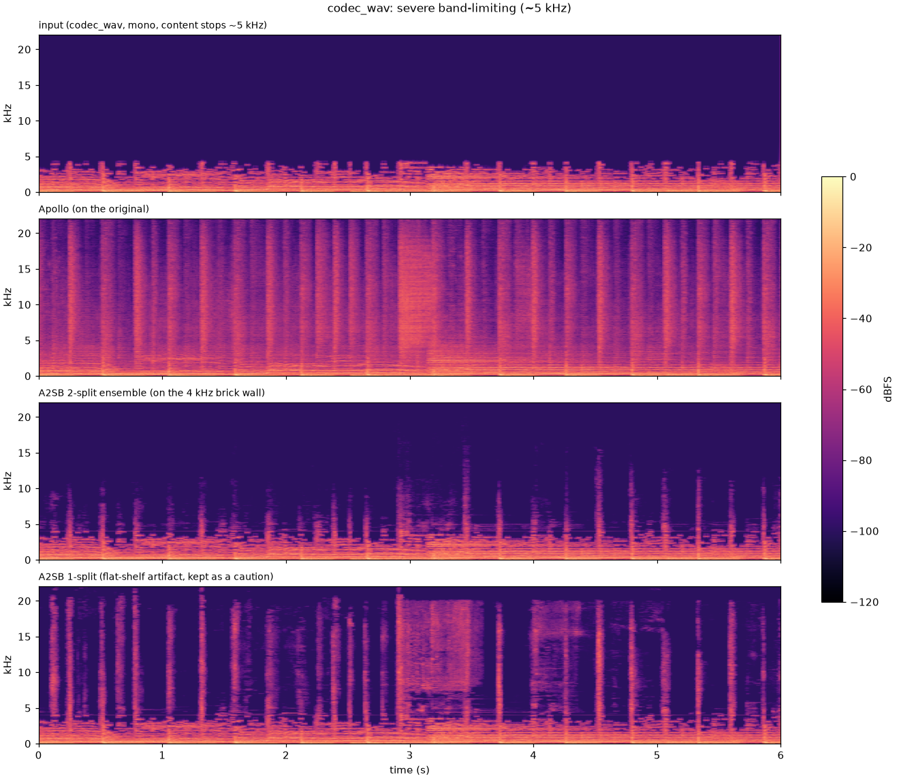
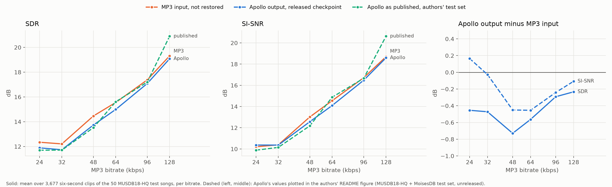

# grooveback

**Restoring records that survive only as MP3, AAC or Opus rips.**

**[Listen to the results](https://zbitouzakaria.github.io/grooveback/listen/)**: two masters (the clean original of
Apollo's 6 s test clip, and a 3-minute electronic excerpt), their MP3s at 32, 64 and 128 kbps, and four restorations
of each MP3: Apollo, A2SB, Apollo → εar-VAE and the εar-VAE damage subtraction.

As a DJ and listener, I keep running into the same problem: records I love that now exist only as rips from YouTube.
Someone played their vinyl through an imperfect rig, saved the transfer as a 128 or 192 kbps MP3, and uploaded it.
YouTube then re-encoded that to AAC or Opus. On laptop speakers the rips are fine. On a good system the damage is easy
to hear: smeared transients, no air at the top, and a flat, tired sound next to the rest of the library.

This project tries to restore them. The target is electronic music: old-school house, minimal, and nearby genres.

## A restorer has to invent what the codec removed

Lossy codecs discard information permanently. They spend their bits where the ear is likely to notice and drop the
rest. A 128 kbps MP3 keeps nothing above about 16 kHz, and below that cut-off it quantizes the signal coarsely, which
smears transients and thins out reverb tails and stereo detail. A YouTube rip carries this damage twice, because
YouTube serves its standard streams as roughly 128 kbps AAC or Opus ([YouTube audio formats](#ref-ytformats)).

So a restorer has to invent what is gone. Its output is plausible, not faithful: coherent with the input and
convincing on good speakers, but not the original master.

Our plan is a prior: a generative model of clean house and minimal music, fine-tuned from
[Stable Audio 3](#ref-sa3) on my library of about 215 hours. It would propose clean audio while a solver keeps it
consistent with the damaged input. Because it learns only clean music, a new kind of damage needs no retraining
([ADR-0004](docs/decisions/0004-restoration-as-a-latent-inverse-problem.md)). We have not trained it yet. First we
measured what the existing tools do, and that is what the rest of this page reports. Each finding links to its decision
record (ADR) in [`docs/decisions/`](docs/decisions/), which holds the evidence.

## What we found

### Apollo beats A2SB on heavy damage, but neither changes how a 128 kbps rip sounds

We started with two open models ([ADR-0006](docs/decisions/0006-baseline-findings.md)): [Apollo](#ref-apollo), trained
to repair MP3-compressed music, and [A2SB](#ref-a2sb), which fills the band above a cut-off. We ran both on one real
128 kbps rip (AN-2, "Moonshine", 7.6 min) and on Apollo's own 6 s test clip, whose content stops at about 5 kHz. We
listened on monitoring headphones, with every track at the same loudness.

On the 6 s clip, Apollo won clearly: it put back a full hi-hat where A2SB added a click. On the 128 kbps rip, both
models filled the band above its 15.75 kHz cut-off, yet the MP3, Apollo and A2SB all sounded the same. Apollo runs
faster than real time on a laptop and keeps the stereo image. A2SB is mono, needs the input cut sharply at the
cut-off, and took about 35 minutes for the 7.6-minute track on an A100. We also tried [SonicMaster](#ref-sonicmaster)
through its online demo and dropped it: it doubles kick drums on electronic music, even when the prompt tells it not to
([ADR-0005](docs/decisions/0005-baselines-and-prior-viability-on-real-library-material.md)).



*Top to bottom: the input, which stops near 5 kHz; Apollo, which fills the band up to 22 kHz; A2SB's 2-split
checkpoint, run on the clip cut at 4 kHz, which adds short bursts; and its 1-split checkpoint, whose wide band of
energy is an artifact, a flat shelf instead of a natural roll-off. We use only the 2-split.*

### At 64 kbps and above, most of the damage is inside the band the MP3 keeps

Real rips have no aligned master to compare with, so we made our own test material: MP3 copies of clean tracks at known
bitrates, scored against the master ([ADR-0007](docs/decisions/0007-benchmark-codec-restoration.md), extended in
[ADR-0011](docs/decisions/0011-benchmark-autoencoder-roundtrips-and-mean-damage-subtraction.md)). Each copy is encoded
once. A YouTube rip is encoded at least twice, so these results describe the easier case.

The cut-off is the damage a spectrogram shows, but not the main one. On a 12 s excerpt of an electronic track at
64 kbps, the master with its top band removed at the MP3's cut-off still scores 27 dB SDR against the full master. If
the cut-off were the only damage, the MP3 would score about 27 dB too. It scores 17.6 dB, so most of the error is inside
the kept band: filling the missing band perfectly would raise its SDR by only about 0.5 dB. A restorer that only fills
the top band, like A2SB, cannot gain much at this bitrate. At 32 kbps the cut-off falls to 5.5 kHz and the missing band
matters more; ADR-0007 did not measure that case.

### No method gets closer to the master than the MP3 on waveform metrics

Waveform metrics (SDR, SI-SNR) compare the restored audio with the master sample by sample, so invented detail at the
wrong phase counts as error. Spectral metrics (spectral SNR and log-spectral distance, or LSD) compare only spectrogram
magnitudes. On the waveform metrics, no method got closer to the master than the untouched MP3, on any source at any
bitrate we tested. Only the spectral metrics, LSD above all, reward restoration. So metrics catch regressions, and
listening decides.

### Stable Audio 3's music clips lose about as much to MP3 as a master does

Our plan depends on Stable Audio 3, so we checked whether its released checkpoints generate audio with the detail of a
real master ([ADR-0008](docs/decisions/0008-sa3-generation-probe.md)). A generated clip has no master, so we used the
MP3 codec as the measuring tool. A clip without fine detail would barely change under MP3 and score a high SDR. At
64 kbps, the MP3s of clips from the four music checkpoints score 10.3 to 21.3 dB SDR against their clips (the mean of
three seeds each), a range that contains the 17.6 dB of the master excerpt's MP3 above. So the clips hold detail for an
MP3 to remove. This is one prompt and three seeds: it does not show that they sound like a master.

### SDEdit keeps the damage it should remove

Our first method was [SDEdit](#ref-sdedit) on the medium Stable Audio 3 model, without fine-tuning
([ADR-0009](docs/decisions/0009-sdedit-as-the-first-solver.md)). It adds noise to the MP3 and lets the model remove
it, in the hope that the codec damage goes with it. It did not. To the model, band-limited audio is plausible music,
so it keeps it. No setting filled the band above the cut-off, and noise we added above the cut-off came back as noise.
A second variant added no noise and only started the denoising late, so that the model would treat the damage itself
as noise. It kept the damage too.

The numbers show why. In the model's latent space, the MP3 damage is as large as noise at level 0.54 to 0.80, where 1.0
is pure noise. To remove it, SDEdit must add at least that much noise, but its output drifts audibly from the input
above 0.25. We rejected SDEdit.

### Running εar-VAE after Apollo helps on heavy damage, by ear

Next we tested four open music autoencoders: [SAME-L](#ref-same) (the autoencoder of Stable Audio 3),
[εar-VAE](#ref-earvae), [εar-VAE2](#ref-earvae2) and [CoDiCodec](#ref-codicodec)
([ADR-0011](docs/decisions/0011-benchmark-autoencoder-roundtrips-and-mean-damage-subtraction.md)). An autoencoder
trained on clean music might return a cleaner track from a round trip, `decode(encode(x))`. We tested three uses at 32,
64 and 128 kbps, on the clean original of Apollo's 6 s test clip and on 3-minute excerpts of two other tracks. Two are
round trips: of the MP3, and of Apollo's output (Apollo → εar-VAE, for example). The third, mean damage subtraction,
computes `decode(encode(x) − d)`, where `d` is the average change the same MP3 bitrate makes to the latents of another
track.

By ear, two of these were worth keeping: Apollo → εar-VAE and the εar-VAE damage subtraction. The rest, every plain
round trip included, sounded worse than these two. Apollo → εar-VAE beats Apollo alone at 32 kbps, ties with it at
64 kbps, and loses at 128 kbps, where Apollo alone sounds closer to the master. To our ears, εar-VAE's decoder smooths
Apollo's output: at 32 kbps this removes artifacts Apollo adds, and at 128 kbps, where Apollo adds few, it moves the
sound away from the master. We have not measured this.

The metrics disagree with the ear. They score Apollo → εar-VAE worse than Apollo alone in all nine source and bitrate
settings, for example an LSD of 11.2 against 10.4 dB (lower is better) at 32 kbps on a 3-minute excerpt of the same
electronic track. The damage subtraction improves the spectrum, not the waveform: across the four autoencoders, three
sources and three bitrates, it brings LSD below the MP3's in 32 of 36 settings, while its SDR stays within 1.2 dB of
the plain round trip's. We measured the damage `d` on one track only, and on another artist's track at 128 kbps it
overcorrects. Our listening is labelled, not blind, so the verdict by ear still needs a blind test.

### On public test songs too, the metrics score Apollo → εar-VAE below Apollo

To score methods on public material, we ported Apollo's own test protocol to the 50 test songs of MUSDB18-HQ, which the
released Apollo was not trained on ([ADR-0015](docs/decisions/0015-reproduce-apollo-test-protocol.md)). On these songs,
Apollo → εar-VAE scores worse than Apollo on all four metrics at every bitrate from 24 to 128 kbps, the same direction
as on our own material. These are not house and minimal tracks, and we did not listen to them.



The dotted line is Apollo's published result on a different test set, so it is not comparable with the solid lines.
The paper's own test set was never released. We checked each step of our port against the authors' code: their
evaluation script and ours give the same mean scores on the same 3,677 clips, for example an SDR of 11.889 dB against
11.891 dB at 24 kbps.

On the way we found a bug in their MP3 simulation. It finds the MP3's delay with a circular cross-correlation that gives
every frequency the same weight. On some clips, the jump from the clip's end back to its start gives a higher peak at
lag 0 than the music gives at the real delay, so the MP3 is not shifted back. That left 2.5% of the 24 kbps clips 25 ms
late, and a method could gain score on them just by shifting the MP3 into place. Tapering both signals with a Hann
window before the search aligns every clip.

## Where this leaves us

By ear, on our MP3 copies of masters, Apollo → εar-VAE is our best restorer for heavily damaged MP3s, and at 128 kbps
Apollo alone sounds closest to the master. The εar-VAE damage subtraction stays on the listening page as a candidate.
On the one real 128 kbps rip we tried, neither Apollo nor A2SB made an audible difference on headphones. The metrics
score Apollo alone above Apollo → εar-VAE at every bitrate.

What comes next:

- **The prior.** Fine-tune Stable Audio 3 on the 215-hour library
  ([ADR-0004](docs/decisions/0004-restoration-as-a-latent-inverse-problem.md)). It works in the latent space of SAME,
  so it cannot sound better than SAME's decoder, and SAME-L's plain round trip was not among the methods we kept by ear.
- **A solver with a constraint.** SDEdit let the model drift from the input. The next solver holds each sampling step
  consistent with the MP3, in the line of [DPS](#ref-dps), [DAPS](#ref-daps) and [LOUDAR](#ref-loudar). Its first
  question: the 50-step base checkpoint is easier to constrain, but we prefer the 8-step one by ear.
- **The same evaluation.** Every new method is scored on the MUSDB18-HQ protocol and heard on the listening pages,
  against Apollo and Apollo → εar-VAE.

## How we listen and measure

Every listening set is matched to −14 LUFS, then lowered by one shared gain to keep peaks under −1 dBFS, because
otherwise loudness decides what sounds better. We listen in browser pages built on
[trackswitch.js](https://github.com/audiolabs/trackswitch.js), which switch between tracks without restarting playback
([ADR-0010](docs/decisions/0010-listen-in-the-browser-with-trackswitch.md)). Metrics are scored against the master.
Tests target failures that raise no error: an identity model sent through the full pipeline must come back unchanged,
and every evaluation also scores the untouched MP3.

## Running it

```bash
git clone --recurse-submodules https://github.com/zbitouzakaria/grooveback.git
cd grooveback
uv sync --all-groups   # Python 3.12 or later; stable-audio-3 pins torch to 2.7.1
uv run pytest
```

- `uv run python -m grooveback.cli.baseline INPUT OUTPUT --method apollo` restores one 44.1 kHz file with Apollo, or
  with A2SB (`--method a2sb --device cuda`).
- `uv run python -m grooveback.cli.musdb_eval musdb18hq/test scores.csv --kbps 24 --earvae` scores one bitrate of the
  MUSDB18-HQ protocol; download the dataset to `musdb18hq/` first. All six bitrates take about an hour on one H100.
- `uv run python scripts/run_xp.py device=cuda` runs our MP3 benchmark. Its source tracks live in `data/`, which is not
  in the repository.
- `uv run python -m grooveback.cli.run model=roundtrip input=INPUT output_dir=DIR` runs a solver through
  [Hydra](https://hydra.cc): `roundtrip`, `sdedit`, or `latent-sub`, which needs a damage vector from `run_xp.py`.
- After `run_xp.py`, `uv run --group notebooks python scripts/publish_listen.py` rebuilds the listening page in
  `docs/listen/` from its renders, replacing the old page.

A2SB runs from its own clone and environment, because its dependencies conflict with ours:
`git clone -b runnable-anywhere https://github.com/zbitouzakaria/diffusion-audio-restoration.git third_party/a2sb`,
then `./setup.sh` inside it. The Stable Audio 3 checkpoints are gated on Hugging Face: accept their license and export
`HF_TOKEN`. The MP3 benchmark needs ffmpeg with libmp3lame, and the MUSDB18-HQ protocol needs sox with MP3 support.

## Related work

The methods differ in what damage they repair and where they work: on the waveform, on spectrograms, or in the latent
space of a neural autoencoder. Most rebuild the band above a cut-off, or fix faults like reverb and clipping. Few
target what MP3, AAC and Opus do inside the band they keep.

- **Supervised restorers** learn from pairs of damaged and clean audio. [Apollo](#ref-apollo) is the only one trained
  on MP3 damage. [SonicMaster](#ref-sonicmaster) does not cover codec damage.
- **Bandwidth extension** rebuilds the band above a cut-off: [AudioSR](#ref-audiosr), [A2SB](#ref-a2sb),
  [AudioLBM](#ref-audiolbm), [HP-codecX](#ref-hpcodec) and [latent upsampling](#ref-latentup). None of them trains on
  codec damage, and AudioSR copies the input's band below the cut-off into its output unchanged.
- **Music autoencoders** give generative models their latent space. [SAME](#ref-same), in a large L and a small S, both
  open, is the space of Stable Audio 3. [εar-VAE](#ref-earvae) and [εar-VAE2](#ref-earvae2) are built to keep phase,
  stereo image and high harmonics. [CoDiCodec](#ref-codicodec) gives continuous and discrete latents from one model,
  and [Elastic Time](#ref-elastic) spends latent frames where the signal is dense. A method that works in a latent space
  cannot sound better than the decoder.
- **Generative music models** a restoration prior could start from: [Stable Audio 3](#ref-sa3), whose small and medium
  checkpoints are open, and [Qwen-Music](#ref-qwenmusic) and [Qwen-Audio-3.0-Gen](#ref-qwengen), which have no open
  weights.
- **Inverse problems with a diffusion prior.** The prior proposes clean audio, and the sampler keeps it consistent with
  the observed signal. [DPS](#ref-dps) introduced this with a known damage model, [SILO](#ref-silo) moved it into a
  latent space, and [DAPS](#ref-daps) reduces the over-smoothing that hides transients. [CQT-Diff](#ref-cqtdiff)
  brought it to music, [BABE](#ref-babe) and [BABE-2](#ref-babe2) apply it to historical recordings without knowing the
  damage, and [LOUDAR](#ref-loudar) learns the unknown damage in a latent space, shown on vocal effects and guitar
  distortion. We found none tried on MP3, AAC or Opus damage.

*Restores* says what a method reconstructs: the **full band** including in-band damage, the **missing band** above a
cut-off, a **round trip** (an autoencoder's `decode(encode(x))`), or a **prior** that needs a solver. A dash means it
does not restore. *Weights* are **open**, **code** only, **closed** (hosted), or **none**.

| Paper | Year | Method | Restores | Targets MP3 | Weights | Tested here |
|---|---|---|---|---|---|---|
| [AudioSR](#ref-audiosr) | 2023 | diffusion SR, mel domain + vocoder | missing band | — | open | — |
| [Apollo](#ref-apollo) | 2024 | band-split GAN, waveform | full band | ✓ | open | ✓ [0006](docs/decisions/0006-baseline-findings.md), [0007](docs/decisions/0007-benchmark-codec-restoration.md), [0011](docs/decisions/0011-benchmark-autoencoder-roundtrips-and-mean-damage-subtraction.md), [0015](docs/decisions/0015-reproduce-apollo-test-protocol.md) |
| [A2SB](#ref-a2sb) | 2025 | Schrödinger bridge, vocoder-free | missing band + gaps | — | open¹ | ✓ [0006](docs/decisions/0006-baseline-findings.md), [0007](docs/decisions/0007-benchmark-codec-restoration.md), [0011](docs/decisions/0011-benchmark-autoencoder-roundtrips-and-mean-damage-subtraction.md) |
| [Latent upsample/upmix](#ref-latentup) | 2025 | supervised latent-to-latent BWE/upmix | missing band | — | none | — |
| [SonicMaster](#ref-sonicmaster) | 2025 | text-guided flow matching, all-in-one | in-band faults² | — | open | demo only, dropped ([0005](docs/decisions/0005-baselines-and-prior-viability-on-real-library-material.md)) |
| [CoDiCodec](#ref-codicodec) | 2025 | consistency autoencoder, continuous + discrete latents | round trip | — | open | ✓ [0011](docs/decisions/0011-benchmark-autoencoder-roundtrips-and-mean-damage-subtraction.md) |
| [εar-VAE](#ref-earvae) | 2025 | perceptual VAE, phase + M/S losses | round trip | — | open | ✓ [0011](docs/decisions/0011-benchmark-autoencoder-roundtrips-and-mean-damage-subtraction.md), [0015](docs/decisions/0015-reproduce-apollo-test-protocol.md) |
| [AudioLBM](#ref-audiolbm) | 2025 | latent bridge SR, cascaded to 192 kHz | missing band | — | none | — |
| [HP-codecX](#ref-hpcodec) | 2025 | codec tokens + transformer LM | missing band | — | open | — |
| [Stable Audio 3](#ref-sa3) | 2026 | latent diffusion prior + inpainting | prior | — | open | ✓ [0008](docs/decisions/0008-sa3-generation-probe.md), [0009](docs/decisions/0009-sdedit-as-the-first-solver.md) (SDEdit, rejected) |
| [SAME](#ref-same) | 2026 | transformer autoencoder, 4096× | round trip | — | open | ✓ [0007](docs/decisions/0007-benchmark-codec-restoration.md), [0011](docs/decisions/0011-benchmark-autoencoder-roundtrips-and-mean-damage-subtraction.md) |
| [Elastic Time](#ref-elastic) | 2026 | dynamic frame-rate bottleneck | — | — | code | — |
| [Qwen-Music](#ref-qwenmusic) | 2026 | semantic-token LLM + stereo renderer | — | — | closed | — |
| [Qwen-Audio-3.0-Gen](#ref-qwengen) | 2026 | DiT + shared VAE, scene generation | — | — | closed | — |
| [LOUDAR](#ref-loudar) | 2026 | latent operator + diffusion prior | full band, blind | — | code | — |
| [εar-VAE2](#ref-earvae2) | 2026 | complex-STFT autoencoder, band refiner | round trip | — | open³ | ✓ [0011](docs/decisions/0011-benchmark-autoencoder-roundtrips-and-mean-damage-subtraction.md) |

¹ Only the 1- and 2-split checkpoints are released; the paper's 4-split ensemble is not.
² Its nineteen faults cover EQ, dynamics, reverb, amplitude and stereo; MP3/AAC/Opus and bandwidth damage are not
among them.
³ The open weights are retrained on public datasets, not the paper's internal corpus. By ear they sound clearly worse
than εar-VAE ([ADR-0011](docs/decisions/0011-benchmark-autoencoder-roundtrips-and-mean-damage-subtraction.md)).

Only one model, Apollo, targets MP3 directly, and it is a supervised model. Outside this project, every generative
method either stops at the missing band or has not been tried on MP3, AAC or Opus. Repairing in-band codec damage with
a generative model is still open.

## References

<a id="ref-audiosr"></a>
[AudioSR] Liu et al. *AudioSR: Versatile Audio Super-resolution at Scale.* [arXiv:2309.07314](https://arxiv.org/abs/2309.07314) · [code](https://github.com/haoheliu/versatile_audio_super_resolution)

<a id="ref-apollo"></a>
[Apollo] Li & Luo. *Apollo: Band-sequence Modeling for High-Quality Audio Restoration.* ICASSP 2025. [arXiv:2409.08514](https://arxiv.org/abs/2409.08514) · [code](https://github.com/JusperLee/Apollo)

<a id="ref-a2sb"></a>
[A2SB] Kong et al. (NVIDIA). *A2SB: Audio-to-Audio Schrödinger Bridges.* [arXiv:2501.11311](https://arxiv.org/abs/2501.11311) · [code](https://github.com/NVIDIA/diffusion-audio-restoration)

<a id="ref-latentup"></a>
[LatentUp] Bralios, Smaragdis, Casebeer. *Learning to Upsample and Upmix Audio in the Latent Domain.* WASPAA 2025. [arXiv:2506.00681](https://arxiv.org/abs/2506.00681)

<a id="ref-sonicmaster"></a>
[SonicMaster] Melechovsky et al. *SonicMaster: Towards Controllable All-in-One Music Restoration and Mastering.* ICML 2026. [arXiv:2508.03448](https://arxiv.org/abs/2508.03448) · [weights](https://huggingface.co/amaai-lab/SonicMaster)

<a id="ref-codicodec"></a>
[CoDiCodec] Pasini, Lattner, Fazekas. *CoDiCodec: Unifying Continuous and Discrete Compressed Representations of Audio.* ISMIR 2025. [arXiv:2509.09836](https://arxiv.org/abs/2509.09836) · [code](https://github.com/SonyCSLParis/codicodec) · [weights](https://huggingface.co/SonyCSLParis/codicodec)

<a id="ref-earvae"></a>
[εar-VAE] Wang et al. *Back to Ear: Perceptually Driven High Fidelity Music Reconstruction.* [arXiv:2509.14912](https://arxiv.org/abs/2509.14912) · [code](https://github.com/Eps-Acoustic-Revolution-Lab/EAR_VAE) · [weights](https://huggingface.co/earlab/EAR_VAE)

<a id="ref-audiolbm"></a>
[AudioLBM] Li et al. *Audio Super-Resolution with Latent Bridge Models.* NeurIPS 2025. [arXiv:2509.17609](https://arxiv.org/abs/2509.17609)

<a id="ref-hpcodec"></a>
[HP-codecX] Giniès et al. *Harmonic-Percussive Disentangled Neural Audio Codec for Bandwidth Extension.* [arXiv:2511.21580](https://arxiv.org/abs/2511.21580) · [code](https://zenodo.org/records/22144166) · [weights](https://zenodo.org/records/22144249)

<a id="ref-sa3"></a>
[SA3] Evans, Parker et al. (Stability AI). *Stable Audio 3.* [arXiv:2605.17991](https://arxiv.org/abs/2605.17991) · [code](https://github.com/Stability-AI/stable-audio-3) · [weights](https://huggingface.co/stabilityai/stable-audio-3-small-music)

<a id="ref-same"></a>
[SAME] Parker, Evans et al. *SAME: A Semantically-Aligned Music Autoencoder.* [arXiv:2605.18613](https://arxiv.org/abs/2605.18613) · [weights](https://huggingface.co/stabilityai/SAME-L)

<a id="ref-elastic"></a>
[Elastic] Bralios, Smaragdis, Kim. *Elastic Time: Dynamic Frame Rate Bottlenecks for Neural Audio Coding.* Interspeech 2026. [arXiv:2606.27320](https://arxiv.org/abs/2606.27320) · [code](https://github.com/dbralios/elastic-time)

<a id="ref-qwenmusic"></a>
[Qwen-Music] Xu et al. (Alibaba). *Qwen-Music Technical Report.* [arXiv:2607.11699](https://arxiv.org/abs/2607.11699)

<a id="ref-qwengen"></a>
[Qwen-Gen] Dai et al. (Alibaba). *Qwen-Audio-3.0-Gen-Preview Technical Report.* [arXiv:2607.27011](https://arxiv.org/abs/2607.27011)

<a id="ref-loudar"></a>
[LOUDAR] Švento et al. *Music Restoration via Latent Operator Optimization and Diffusion Model Priors.* ISMIR 2026. [arXiv:2608.01972](https://arxiv.org/abs/2608.01972) · [code](https://github.com/michalsvento/loudar) · [demo](https://michalsvento.github.io/loudar/)

<a id="ref-earvae2"></a>
[εar-VAE2] Wang, Dai, Xu. *Fourier is Frontier: Frequency-Aware Autoencoding for High-Fidelity Music Reconstruction.* [arXiv:2608.19843](https://arxiv.org/abs/2608.19843) · [code](https://github.com/Eps-Acoustic-Revolution-Lab/EAR_VAE2) · [weights](https://huggingface.co/earlab/EAR_VAE2) · [demo](https://eps-acoustic-revolution-lab.github.io/EAR_VAE2/)

<a id="ref-sdedit"></a>
[SDEdit] Meng et al. *SDEdit: Guided Image Synthesis and Editing with Stochastic Differential Equations.* ICLR 2022. [arXiv:2108.01073](https://arxiv.org/abs/2108.01073)

<a id="ref-dps"></a>
[DPS] Chung et al. *Diffusion Posterior Sampling for General Noisy Inverse Problems.* [arXiv:2209.14687](https://arxiv.org/abs/2209.14687)

<a id="ref-silo"></a>
[SILO] Raphaeli, Man, Elad. *SILO: Solving Inverse Problems with Latent Operators.* ICCV 2025. [arXiv:2501.11746](https://arxiv.org/abs/2501.11746)

<a id="ref-daps"></a>
[DAPS] Zhang et al. *Improving Diffusion Inverse Problem Solving with Decoupled Noise Annealing.* CVPR 2025. [arXiv:2407.01521](https://arxiv.org/abs/2407.01521)

<a id="ref-cqtdiff"></a>
[CQT-Diff] Moliner, Lehtinen, Välimäki. *Solving Audio Inverse Problems with a Diffusion Model.* [arXiv:2210.15228](https://arxiv.org/abs/2210.15228)

<a id="ref-babe"></a>
[BABE] Moliner et al. *Blind Audio Bandwidth Extension: A Diffusion-Based Zero-Shot Approach.* [arXiv:2306.01433](https://arxiv.org/abs/2306.01433)

<a id="ref-babe2"></a>
[BABE-2] Moliner et al. *A Diffusion-Based Generative Equalizer for Music Restoration.* DAFx-24. [arXiv:2403.18636](https://arxiv.org/abs/2403.18636)

<a id="ref-ytformats"></a>
[YT-Formats] Eesmaa, M. *YouTube Audio Formats — itags, codecs and bitrates.* [gist](https://gist.github.com/MartinEesmaa/2f4b261cb90a47e9c41ba115a011a4aa)

---

The code here is MIT-licensed. The third-party code it runs has its own licenses: Apollo CC BY-SA 4.0, A2SB the NVIDIA
Source Code License (non-commercial), εar-VAE and εar-VAE2 Apache-2.0, CoDiCodec CC BY-NC 4.0, and the vendored
trackswitch.js player MIT. The Stable Audio 3 checkpoints are released under the
[Stability AI Community License](https://stability.ai/license), which any weights adapted from them would inherit; it
permits the personal and research use this project is scoped to. The audio on the listening page belongs to its owners
and is not covered by the MIT license.
