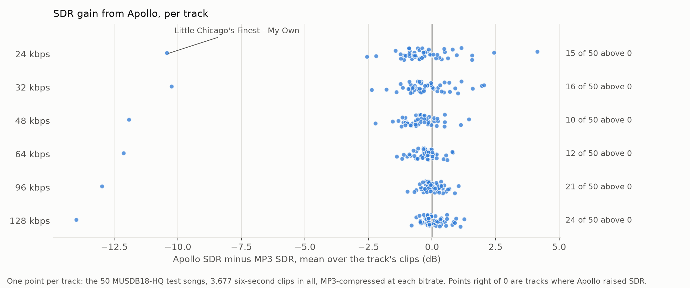

# 15. Reproduce Apollo's test protocol on the MUSDB18-HQ test mixtures

Date: 2026-10-20

## Status

Accepted — on the 50 held-out MUSDB18-HQ test mixtures, Apollo scores below the untouched MP3 on SDR at all six
bitrates, and within 0.8 dB of its advertised points up to 96 kbps.

## Context

Apollo (Li & Luo, ICASSP 2025) is this project's strongest baseline (ADR-0006). The paper reports it on "the combined
test set of MUSDB18-HQ and MoisesDB (with 5000 samples for each case)", MP3-compressed at 24, 32, 48, 64, 96 and
128 kbps. That set was never released. The authors' dataset `JusperLee/Apollo-val-test-data` on Hugging Face contains
only a README, and the paper never identifies its MoisesDB songs, so the paper's set cannot be rebuilt.

The MUSDB18-HQ test split can be used instead. The maintainer states that it "was not used to train or retrain the
released checkpoint" ([JusperLee/Apollo#46](https://github.com/JusperLee/Apollo/issues/46#issuecomment-6281774888)),
so its 50 songs are a held-out test for Apollo, and later for this project's own methods.

## Decision

### The test set

`python -m grooveback.cli.musdb_eval musdb18hq/test scores.csv --kbps K` scores Apollo and the untouched MP3 on these
songs. Each step is the authors' released code, ported:

| step | source |
|---|---|
| 6 s sessions of each test mixture, 3 s hop, kept when over half of their 10 ms frames exceed the track's 15th-percentile power | `VAD` in [Apollo-data-preprocess](https://github.com/JusperLee/Apollo-data-preprocess) `musdb_preprocess.py` |
| MP3 through torchaudio's sox at the bitrate, cut to length, rolled into alignment by `match2` | `codec_simu`, `look2hear/datas` |
| both signals divided by their joint peak | same file |
| Apollo once over each whole clip | `test.py` |
| SDR: fast_bss_eval, 512-tap filter, zero mean; SI-SNR: fast_bss_eval `si_sdr`, zero mean; both averaged over channels | `look2hear/metrics/wrapper.py` |

The released code does not settle three choices:

- **Whole mixtures, not the paper's categories.** The paper splits its clips into four categories of stems. Those
  categories only serve a comparison with the paper's set, which cannot be rebuilt. The mixtures are the songs as
  released, with no mixing choice of this project's own.
- **Metrics in float64.** The authors compute in float32 on the GPU. On their 15 published demo triplets the two differ
  by at most 0.05 dB per clip.
- **The same clips at every bitrate.** The sessions are cut from the clean mixture, so all six bitrates score the same
  3,677 clean clips.

### Exactness gates

Where the published material allows a check:

- **Model and metrics.** Apollo rendered here on the authors' three 24 kbps demo inputs matches their published outputs
  to 76–80 dB. The SDR / SI-SNR of ours and theirs are identical to two decimals: 9.83 / 8.24, 11.27 / 9.32,
  11.82 / 9.66.
- **Codec.** `codec_simu` on the authors' clean demo clips reproduces their MP3's 4,250 Hz edge, and its SDR against
  the clean clip within 0.02–0.17 dB. A bit-exact match cannot be checked, because their pairs were rescaled after
  encoding. The MP3 here goes through the system libsox from torchaudio 2.8.0, not the authors' torchaudio 2.0.1
  build.
- **Sessions.** The authors' unmodified `musdb_preprocess.py` (Apollo-data-preprocess at `bb37a7b`), run on each of
  the 50 test mixtures as a 16-bit WAV copy of its FLAC, stores the same 3,677 sessions as `musdb_eval`. Every session
  starts at the same position and is identical sample for sample. The float32 cast `musdb_eval` applies loses
  nothing, since 16-bit values fit in float32.
- **Their evaluation.** The authors' own `test.py` and metric code (Apollo at `b17bf53`), run on the same 3,677 clips
  at 24 kbps, give the same means as `musdb_eval`: SDR 11.889 against 11.891 dB, SI-SNR 10.368 against 10.368 dB.
  `test.py` cannot run as released: it loads `look2hear.models.GullFullband`, which is never defined, and reads a
  `codec-test` folder whose generating script was never published. Two things were changed: the model loads from the
  released checkpoint as their `inference.py` does, and ViSQOL is skipped. The pairs were written with their own
  `musdb_preprocess.py`, `codec_simu` and joint-peak rescale. Per clip, SI-SNR is identical, and SDR differs only where
  `test.py`'s float32 differs from the float64 here. Their per-clip output is `assets/0015/test-py-24k.csv`.

  
- **Rerun.** 24 kbps scored a second time on a different pod, on the first two tracks (128 clips), reproduces every
  per-clip score of the first run to within 3e-12 dB.

### The advertised numbers

The paper reports bitrates only as a figure (Fig. 2), which prints no numbers. The per-bitrate points here are read
off the same comparison in Apollo's README (`asserts/bitrates.png`), calibrated on its gridlines, with a fit residual
under 0.005 dB.

Table II of the paper reports the four categories. Its Overall column, SDR 16.64 / SI-SNR 16.00 dB, is the mean of the
four category values. It exceeds the mean of the six figure points, 15.11 / 14.06 dB, by 1.53 / 1.94 dB. The paper
does not say which bitrates Table II covers.

Neither the figure nor the paper reports a score for the untouched MP3.

### Two scores per bitrate

Each bitrate is reported over all clips, which is the number comparable to the paper, and over the aligned clips only,
which is the number that measures restoration. The reason is the alignment failure described under Results.

## Results (2026-10-20 run)

SDR / SI-SNR in dB against the clean clip, 3,677 clips from 50 tracks per bitrate. Per-clip scores and lags are in
[assets/0015](assets/0015).

### Against the advertised points

| kbps | untouched MP3 | Apollo | advertised (README figure) | Apollo − advertised | Apollo − MP3 |
|---|---|---|---|---|---|
| 24 | 12.34 / 10.20 | 11.89 / 10.37 | 11.70 / 9.88 | +0.19 / +0.49 | −0.45 / +0.17 |
| 32 | 12.21 / 10.39 | 11.74 / 10.36 | 11.71 / 10.15 | +0.03 / +0.21 | −0.47 / −0.03 |
| 48 | 14.46 / 13.02 | 13.73 / 12.57 | 13.52 / 12.18 | +0.21 / +0.39 | −0.73 / −0.45 |
| 64 | 15.56 / 14.55 | 14.99 / 14.10 | 15.61 / 14.88 | −0.62 / −0.78 | −0.56 / −0.45 |
| 96 | 17.37 / 16.72 | 17.08 / 16.48 | 17.20 / 16.66 | −0.12 / −0.18 | −0.29 / −0.24 |
| 128 | 19.31 / 18.70 | 19.08 / 18.59 | 20.90 / 20.63 | −1.82 / −2.04 | −0.23 / −0.11 |
| mean of six | 15.21 / 13.93 | 14.75 / 13.74 | 15.11 / 14.06 | −0.35 / −0.32 | −0.46 / −0.19 |
| Table II overall | | | 16.64 / 16.00 | −1.89 / −2.26 | |

- **Apollo scores below the untouched MP3 on SDR at every bitrate, by 0.23–0.73 dB.** On SI-SNR it is below at every
  bitrate except 24 kbps. Per track, it raises SDR on fewer than half of the 50 songs at every bitrate (figure
  below).
- **Apollo lands within 0.62 dB SDR and 0.78 dB SI-SNR of the advertised points at 24–96 kbps, and 1.82 / 2.04 dB
  below at 128 kbps.**
  Averaged over the six bitrates, it sits 0.35 / 0.32 dB below the figure and 1.89 / 2.26 dB below Table II.
- **The untouched MP3 alone reaches the advertised Apollo SDR at 24, 32, 48 and 96 kbps, and is 0.05 dB short at
  64 kbps.** The paper reports no score for the untouched MP3, so it cannot show how much Apollo gained on its own
  test set.

### The alignment failure

`codec_simu` rolls the decoded MP3 by the lag that `match2` finds on the first channel. On some clips `match2` returns
the wrong lag, and the decoded MP3 stays 1,105 samples late: LAME's 576-sample encoder delay plus the decoder's 529.
The lag below is measured per clip as the peak of the circular cross-correlation between the channel sums of the MP3
and the clean clip. A clip counts as aligned when that lag is at most 2 samples.

| kbps | MP3 late by 1,104–1,106 samples | other lag over 2 samples | late clips Apollo returns with SI-SNR > 0 dB | aligned clips | aligned: untouched MP3 | aligned: Apollo | aligned: Apollo − MP3 |
|---|---|---|---|---|---|---|---|
| 24 | 93 | 2 (−4,706; 7,556) | 92 of 93 | 3,582 | 12.76 / 11.03 | 11.86 / 10.33 | −0.90 / −0.71 |
| 32 | 68 | 1 (7,556) | 68 of 68 | 3,608 | 12.49 / 10.99 | 11.70 / 10.32 | −0.79 / −0.67 |
| 48 | 25 | 0 | 25 of 25 | 3,652 | 14.56 / 13.24 | 13.70 / 12.53 | −0.86 / −0.71 |
| 64 | 10 | 0 | 10 of 10 | 3,667 | 15.58 / 14.62 | 15.00 / 14.10 | −0.58 / −0.52 |
| 96 | 5 | 0 | 0 of 5 | 3,672 | 17.39 / 16.74 | 17.11 / 16.51 | −0.28 / −0.23 |
| 128 | 2 | 0 | 0 of 2 | 3,675 | 19.32 / 18.71 | 19.09 / 18.60 | −0.23 / −0.10 |

- **The late clips fall with the bitrate, from 2.5% at 24 kbps to 2 clips at 128 kbps.** At 24 kbps they come from 23
  of the 50 tracks. A late MP3 scores −21.1 dB SI-SNR on average, and Apollo's output on the same clips
  scores 12.6 dB.
- **Apollo undoes the delay on 195 of the 196 late clips at 24–64 kbps, and on none of the 7 at 96–128 kbps.** A late
  clip at 24–64 kbps scores far below 0 dB SI-SNR, so an output above 0 dB has been moved back into place. A model only
  learns to undo a delay if its training pairs carried it, so Apollo's training pairs carried this delay, as pairs made
  by the released `codec_simu` would. This conflicts with the maintainer's reply in Apollo's issue #13: "Currently, I
  am using perfectly synchronized codec and original files"
  ([comment](https://github.com/JusperLee/Apollo/issues/13#issuecomment-2511437902)).
- **On aligned clips, the untouched MP3 scores higher than Apollo at every bitrate: by 0.58–0.90 dB SDR at 24–64 kbps
  and 0.23–0.28 dB at 96–128 kbps.** Over all clips at 24 kbps, Apollo gains 0.17 dB SI-SNR on its input; over the
  aligned clips, it loses 0.71 dB. This agrees with ADR-0007, where the untouched MP3 led Apollo on BSS-SDR, SDR and
  SI-SNR on this project's own aligned MP3 twins, and Apollo led only on the spectral metrics.

### One track Apollo fails on

"Little Chicago's Finest - My Own" (88 clips) is the leftmost point at every bitrate in the per-track figure: Apollo's
output on it scores about 2 dB SDR, against 12.45 dB for the MP3 at 24 kbps. That MP3 scores 0.0 dB SI-SNR although
it is aligned: both of its channels sit at lag 0. The track's two channels are nearly uncorrelated, with a correlation of
0.02 over the whole track. It holds every aligned clip with negative input SI-SNR, 54 of them at 24 kbps.

Without this track, Apollo still scores below the untouched MP3 on aligned clips at 24–64 kbps, by 0.30–0.66 dB SDR,
and within 0.13 dB of it at 96–128 kbps. The finding above does not depend on it.

### Training data

The released preprocessing puts MUSDB18-HQ's test stems in the same folders as its training stems. This was measured
by running `musdb_preprocess.py` from Apollo-data-preprocess at `bb37a7b`, unmodified, on the first 3 `train/` and the
first 3 `test/` tracks of MUSDB18-HQ. It writes one folder per stem, `sample1.hdf5` to `sample6.hdf5`, with no train
or test level. Matched sample for sample against the source WAVs, `sample1`–`sample3` are the train tracks and
`sample4`–`sample6` the test tracks in every stem folder. The training loader picks files with
`random.choice(os.listdir(...))` (`look2hear/datas/musdb_moisesdb_datamodule.py`, line 104), so it would sample both
alike.

The maintainer states that the test split was not used for the released checkpoint, and that the public script does
not reflect the training data actually selected for it
([JusperLee/Apollo#46](https://github.com/JusperLee/Apollo/issues/46#issuecomment-6281774888)).

### Stem mixes, tried and replaced

The first version of this set rebuilt the paper's four categories from MUSDB18-HQ test stems, with the authors'
training mixer: stems from random tracks and sessions, each gained by a whole number of dB in [−10, 10], 250 clips
per category, seed 0. On it Apollo scored between 0.8 dB below and 1.7 dB above the advertised points, 13.17 / 11.45 dB
at 24 kbps. The MP3 stayed late on 13.3% of its clips at 24 kbps, mostly single-stem clips, against 2.5% on the
mixtures. Table II's category ordering did not reproduce: Apollo's SDR rises by 4.5 dB from vocal to multi-stems +
vocal there, and stayed within 1.4 dB across the four categories here. On its aligned clips the untouched MP3 also
scored higher than Apollo up to 64 kbps.

It was replaced when MoisesDB was dropped, because the categories only served a comparison with the paper's set. Its
per-clip scores and lags are on the network volume `grooveback-US-MO-1`, as `/workspace/apollo-musdb/{k}k-scores.csv`
and `{k}k-lags.csv`.

## Consequences

- The 50 test mixtures at six bitrates are the project's held-out score for Apollo, and for later methods.
  `musdb_eval` runs Apollo only; scoring another method on it means passing that method in.
- Results on this set report the aligned clips next to all clips. Over all clips, any method that realigns its output
  gains about 34 dB SI-SNR on each late clip at 24 kbps without restoring anything.
- `match2` stays as the authors wrote it. Fixing the alignment would make the set cleaner and less comparable to the
  paper.
- One bitrate takes about 90 minutes on an L40S pod. Bitrates run side by side on one pod as separate processes:
  five ran in 90 minutes, for about $1.65, with `OMP_NUM_THREADS=2` each. Torch on a pod sees all of the host's cores
  (128–256), while the container is allowed 13–27, so the threads are capped to fit.

## Revisit triggers

- The authors share the paper's test clips → score Apollo on them directly.
- ViSQOL is added → compare against the figure's third panel.
- A method of this project is ready → score it on all six bitrates, aligned clips reported separately.
