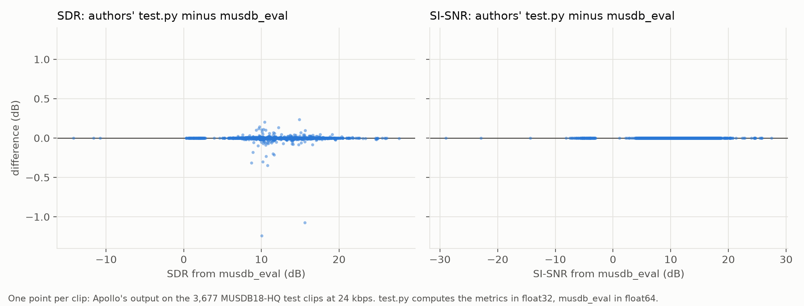
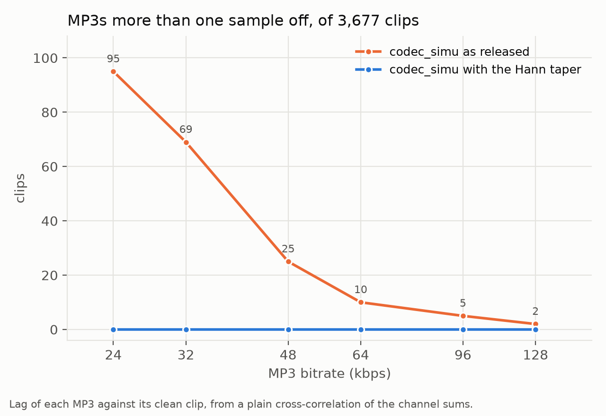

# 15. Reproduce Apollo's test protocol on the MUSDB18-HQ test mixtures

Date: 2026-10-20

## Status

Accepted — we score Apollo, and Apollo followed by εar-VAE, at six MP3 bitrates (24, 32, 48, 64, 96 and 128 kbps) on
the 50 MUSDB18-HQ test mixtures, with the authors' own preprocessing, codec simulation and metrics. One fix to their
`codec_simu` keeps every MP3 within one sample of its clean clip.

## Context

Apollo (Li & Luo, ICASSP 2025) is this project's strongest baseline (ADR-0006). The paper reports it on "the combined
test set of MUSDB18-HQ and MoisesDB (with 5000 samples for each case)", MP3-compressed at 24 to 128 kbps. That set was
never released: the authors' `JusperLee/Apollo-val-test-data` on Hugging Face holds only a README, and the paper never
names its MoisesDB songs.

We use the MUSDB18-HQ test split instead. The maintainer states that it "was not used to train or retrain the
released checkpoint" ([JusperLee/Apollo#46](https://github.com/JusperLee/Apollo/issues/46#issuecomment-6281774888)),
so its 50 songs are a held-out test for Apollo, and later for this project's own methods.

## Decision

`uv run python -m grooveback.cli.musdb_eval musdb18hq/test scores.csv --kbps K --ae earvae` scores, per clip, the
untouched MP3, Apollo, εar-VAE's round trip of the MP3, and Apollo → εar-VAE (Apollo's output after an εar-VAE round
trip, ADR-0011). Each step is ported from the authors' released code:

- 6 s clips of each mixture with a 3 s hop, kept by the authors' loudness filter (`VAD` in Apollo-data-preprocess's
  `musdb_preprocess.py`): 3,677 clips, the same at every bitrate;
- MP3 through torchaudio's sox, shifted back into alignment by the lag that `match2` finds (`codec_simu`), then both
  signals divided by their joint peak, as in `look2hear/datas`;
- Apollo once over each whole clip (`test.py`);
- SDR and SI-SNR as in `look2hear/metrics/wrapper.py`. We add spectral SNR and log-spectral distance (LSD),
  as in ADR-0007.

Departures from the released code and the paper:

- **The alignment fix.** `codec_simu` applies a Hann window to both signals for `match2`'s lag search. As released, it
  leaves some MP3s 25 ms late (below).
- **Whole mixtures.** The paper also scores four categories of stem mixes, which only serve a comparison with its own
  test set. An earlier version rebuilt them from the test stems with the authors' training mixer, and was dropped
  along with MoisesDB.

### Checks against the authors' code

Each check runs one step of `musdb_eval` and the authors' own code, or their published files, on the same input, and
compares the results. All use `codec_simu` as released, before the fix.

- **Apollo.** The authors publish three 24 kbps example MP3s with Apollo's output. Our Apollo, run on those MP3s, gives
  the same outputs (76–80 dB SNR between theirs and ours), and the same SDR and SI-SNR to two decimals.
- **MP3.** Our `codec_simu`, run on the clean versions of those three examples, gives MP3s with the same frequency
  cut-off as theirs, and an SDR against the clean clip within 0.2 dB of theirs. One of their MP3s is one sample late;
  it is compared after shifting it back.
- **Clips.** The authors' preprocessing script (Apollo-data-preprocess at `bb37a7b`), run unchanged on the 50 test
  songs, cuts exactly the same 3,677 clips as `musdb_eval`, sample for sample.
- **Scores.** The authors' evaluation script, `test.py` (Apollo at `b17bf53`), run on the same clips at 24 kbps, gives
  the same average scores as `musdb_eval`: SDR 11.889 dB for theirs and 11.891 dB for ours, SI-SNR 10.368 dB for both.

  

## Results (2026-10-22)

Apollo → εar-VAE scores worse than Apollo on all four metrics at every bitrate, and changes little with bitrate. The
dotted line is Apollo as published, read off the bitrate figure in Apollo's README, as the paper prints no values. It
comes from a different test set, MUSDB18-HQ plus an unreleased selection of MoisesDB songs, and is not comparable with
the solid lines.

### `codec_simu` as released leaves some MP3s late

We measured each clip's lag as the peak of a plain circular cross-correlation between the channel sums of the MP3 and
the clean clip. With `codec_simu` as released, the MP3 stays 1,105 samples (25 ms) late on 2.5% of the clips at 24
kbps, and on fewer at higher bitrates. The 1,105 samples are LAME's 576-sample encoder delay plus the decoder's 529.
Two clips are shifted by thousands of samples instead.

`match2` cross-correlates in the frequency domain with a phase transform: each bin of the cross-spectrum is divided by
its own magnitude, so every frequency has nearly the same weight, whatever its energy. The FFT treats each 6 s clip as
periodic, so the jump from its last sample back to its first is a step at position 0, in the clean clip and in the
MP3, with energy at every frequency. The MP3's low-pass cannot remove this step, because it is in the analysis, not in
the audio. Below the MP3's cut-off, both signals hold music, which points to 1,105 samples. Above it, the MP3 holds
only its step, which points to lag 0 wherever the clean clip's own step is stronger than its music. At 24 kbps, the
peak at lag 0 is higher than the one at 1,105 on 93 of the 95 misaligned clips, and on none of 100 aligned clips.

The fix applies the Hann window to both signals for the lag search only; the MP3 itself is shifted untapered. With it,
every MP3 at every bitrate is within one sample of its clean clip (figure). Zero-padding instead fixes only 32 of the
95 misaligned clips at 24 kbps, because the padding makes new edges.

The MP3 delay is the same 1,105 samples on every clip, so a constant shift would also align it. The lag search is kept
because it needs no known delay: other codecs such as AAC and Opus, and chains such as MP3 then AAC, each have their
own. These formats also record their delay in the file, and ffmpeg removes it when decoding: a 6 s noise clip through
ffmpeg came back at lag 0 for MP3, AAC, Opus and MP3 then AAC. A codec path through ffmpeg would not need the search.

## Consequences

- The 50 test mixtures at six bitrates are the project's held-out score for Apollo and for later methods. Another
  method is scored by adding it to `musdb_eval.evaluate`, or, if it needs its own environment, by passing its
  renders with `--render` (ADR-0016).
- With `codec_simu` as released, a method could raise its score on the late clips just by shifting the MP3 back into
  place; with the fix it cannot.
- Six bitrates with Apollo → εar-VAE take about an hour on one H100 pod, about $5.

## Revisit triggers

- The authors share the paper's test clips → score Apollo on them directly.
- ViSQOL is needed → add it to `musdb_eval`.
- A method of this project is ready → score it on all six bitrates.
